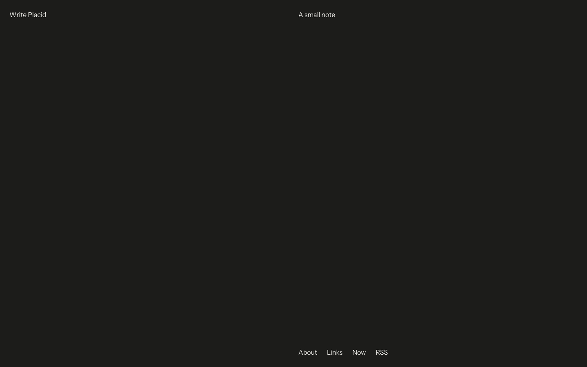
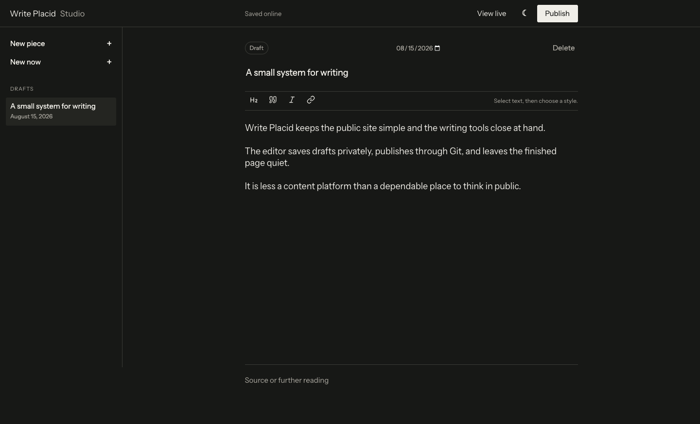
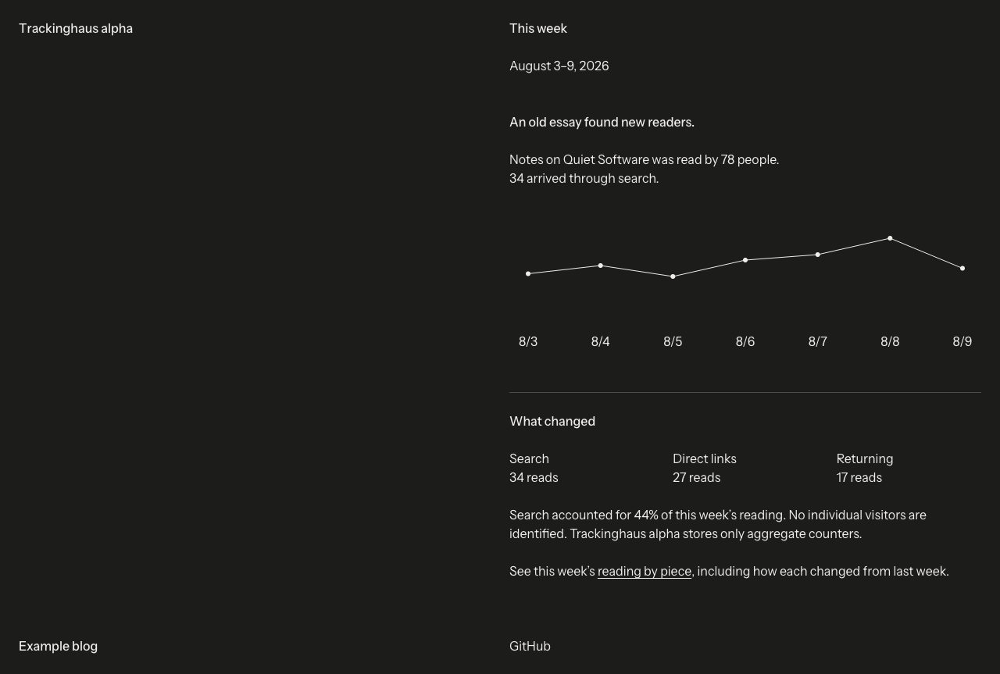

# Write Placid

Write Placid is an open-source template for publishing your own writing. Start with a public site and add a private editor or analytics if you need them. The template comes with sample writing you can replace. [See the live demo](https://maxpfennig.haus/write-placid/).



## What is included

- [**Site**](apps/site/README.md) builds a static website from Markdown. It includes essays, standalone pages, an RSS feed, and a `/now` page for your latest update.
- [**Studio**](apps/studio/README.md) is an optional private editor that works on phones. It can store private drafts in Cloudflare D1. kDrive storage and Google Docs sync are optional. When publishing is enabled, Studio sends the Markdown files to GitHub.
- [**Drafts MCP**](apps/drafts-mcp/README.md) lets a compatible AI assistant save a complete draft or revision to Studio. Studio handles publishing and deletion.
- [**Trackinghaus**](apps/trackinghaus/README.md) is an optional public dashboard that shows weekly page-view counts.

The public site serves static files, so readers can visit it when Studio is offline.

| Studio editor | Trackinghaus dashboard |
| --- | --- |
|  |  |

## Demo Studio

The demo Studio requires an approved Cloudflare Access sign-in. You can open it from an article's **Edit** link after adding `#edit` to the article's address. [Open the demo Studio](https://write-placid-studio.maxpfennighaus.workers.dev/).

Choose **New piece** to create a private draft. Studio saves changes automatically. Wait for **Saved online** before closing the tab. You can reopen the draft in a fresh tab. **Delete** removes it from the library and keeps a private recovery copy.

Publishing is disabled in the demo, so the **Publish** button is hidden.

## Start locally

You’ll need Git and Node.js 22.13 or newer. `npm run setup` installs dependencies for all four apps.

If you’re using PowerShell on Windows with Git Bash installed, set npm to use Bash before running the preview commands.

```powershell
$env:npm_config_script_shell = 'C:\Program Files\Git\bin\bash.exe'
```

```bash
git clone https://github.com/mxpf/write-placid.git
cd write-placid
npm run setup
npm run dev:site
```

Open the local URL printed in your terminal. Replace the sample Markdown in [`apps/site/content`](apps/site/content) and set your site’s name, description, and URL in [`apps/site/site.config.json`](apps/site/site.config.json). The [content guide](apps/site/docs/content-contract.md) explains how to keep links working when you edit or move a page.

The [setup guide](docs/SETUP.md) covers publishing to GitHub Pages and configuring the optional apps. To preview Studio or Trackinghaus locally, use `npm run dev:studio` or `npm run dev:tracking`.

## Run the checks

Install Chromium for the browser tests after running setup. Then run the project checks and Site lint from the repository root.

```bash
npm exec --prefix apps/site -- playwright install chromium
npm run check
npm run lint --prefix apps/site
```

The checks run in PowerShell on Windows and in the default shell on macOS and Linux. Browser tests choose their own local ports, so other previews can stay open.

## Design and shared code

The design keeps the focus on the writing with simple typography, underlined links, and generous spacing. It uses Instrument Sans and the [Thinkinghaus color palette](docs/DESIGN.md).

Make Placid and Write Placid laid the groundwork for [maxpfennig.haus](https://maxpfennig.haus) and Max Pfennighaus’s publication, [Thinkinghaus](https://thinking.haus). Other sites can use a specific release of `@mxpf/write-placid-core` and keep their own content, design, and hosting. See the [core package guide](docs/CORE.md) and [Thinkinghaus parity notes](docs/PARITY.md).

## Ownership

The code uses the [MIT License](LICENSE). Instrument Sans uses the [SIL Open Font License](docs/Instrument-Sans-OFL.txt). Your writing remains yours.
